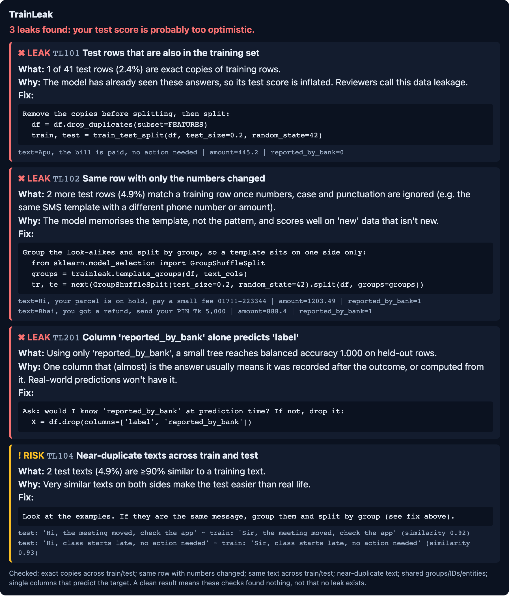

# TrainLeak

**Is your test score real?** One line tells you if your ML data or notebook leaks test information into training, and shows the exact code to fix it.

[](https://colab.research.google.com/github/reazulzishan/TrainLeak/blob/main/examples/quickstart.ipynb)
[](https://github.com/reazulzishan/TrainLeak/actions/workflows/ci.yml)
 



Data leakage is one of the most common reasons ML results don't hold up: a model that scores 99 % because the test set
was, in some way, already in training. TrainLeak catches the common, mechanical causes in seconds, written for students
and researchers: every finding says **what** it found (with real numbers), **why** it matters, and **how to fix it**.

## Install

```bash
pip install trainleak            # add [parquet] for .parquet files, [excel] for .xlsx, [all] for both
```

## Use

```python
import trainleak

trainleak.demo()                                     # see it work first, no data needed
trainleak.check(df)                                  # one dataset, before you split
trainleak.check(train_df, test_df, target="label")   # after you split
trainleak.check(X_train, X_test, y_train, y_test)    # sklearn style
trainleak.check_code("my_notebook.ipynb")            # SMOTE / scaling before the split
```

In Jupyter, Colab or Kaggle the result shows as the card above. From a terminal:

```bash
trainleak train.csv test.csv --target label
trainleak analysis.ipynb
trainleak data.csv --report leakage_report.md        # a report to attach to your thesis or paper
```

Exit code `0` = no leak found, `1` = leak found, `2` = bad input, so it also works in CI and pre-commit.
`--quiet` prints one line, `--json` gives machine-readable output, `--ignore TL304` hides a finding type.

## What it checks

| Code | Check | Level |
|---|---|---|
| TL101 | Test rows that are exact copies of training rows | leak |
| TL102 | Same row with only the numbers changed (same SMS template, new phone number or amount); ignores case, punctuation, spacing; keeps Bangla letters and marks | leak |
| TL103 | Same text in train and test while other columns differ | leak |
| TL104 | Near-duplicate texts across train and test (≥ 90 % similar, character n-grams) | risk |
| TL105 / TL106 | The same group (`group=`) or ID on both sides | leak |
| TL107 | Test data is not later than training data | risk |
| TL108 | Same product / user / patient… values on both sides | risk |
| TL201 | One column alone predicts the target (recorded after the outcome, or computed from it) | leak (≥ 0.98) / risk (≥ 0.9) |
| TL301 – TL304 | Inside one dataset: copies, repeated texts, repeated IDs, many rows per entity | risk / info |
| TL401 – TL403 | Notebook/script: SMOTE (or another resampler) before the split or on test data; anything fitted on test data | leak |
| TL404 | Notebook/script: scaler, imputer, PCA, vectoriser… fitted on all data before the split (target encoders and feature selection: leak) | risk / leak |
| TL405 – TL406 | Notebook/script: features chosen with the target on all data; resampling + cross-validation without an imblearn Pipeline | risk |

TrainLeak guesses the target, text, ID and date columns from names and content, and tells you what it assumed. Pass
`target=`, `text=`, `group=`, `time=` to set them yourself.

## What it does not check

- Leakage you can only see with domain knowledge (a feature that is technically "available" but wouldn't be in practice).
- Choosing the model or hyperparameters on the test set (planned).
- Code it can't read as text: the notebook check reads your code line by line; it doesn't follow functions across files.

**A clean report means these checks found nothing. It is not a proof that no leak exists.**

## Tested on real projects

Run without tuning on four real projects whose leaks were already known (details and data credits:
[examples/REAL_CASES.md](examples/REAL_CASES.md)):

- **Bangla/English scam SMS** (Hugging Face): 93 test messages that are a training message with a new number, plus 48
  near-duplicates. A careful manual check had found 81. About 2 seconds.
- **NYC Airbnb listings**: found the column that *is* the price (R² 1.000). About 2 seconds.
- **78,130 Bangladeshi e-commerce reviews**: 13,983 repeated reviews, and that the `Emotion` label predicts `Sentiment`
  perfectly (one is derived from the other). About 3 seconds.
- **Five leak-safe notebooks**: no false alarms.

## Privacy and safety

- Runs on your computer. No uploads, no telemetry, no network calls (there is a test for this).
- Notebooks and scripts are **read, never run**.
- Won't open file types that can run code when loaded (`.pkl`, `.joblib`, `.npy`…). Details: [SECURITY.md](SECURITY.md).
- Reports include a few example rows from your data: check them before sharing a report publicly.

## How it compares (November 2026)

| | TrainLeak | [deepchecks](https://docs.deepchecks.com/stable/tabular/auto_checks/train_test_validation/index.html) | [cleanlab Datalab](https://docs.cleanlab.ai/stable/tutorials/datalab/datalab_quickstart.html) | [splitcheck](https://github.com/aghasalim/splitcheck) | [leakage-analysis](https://github.com/malusamayo/leakage-analysis) |
|---|---|---|---|---|---|
| Copies across train/test | ✓ | ✓ | ✓ (near-duplicates) | ✓ | – |
| Same text with numbers changed | ✓ | – | partial | – | – |
| One column predicts the target | ✓ | ✓ | – | ✓ | – |
| Notebook code (SMOTE / scaling before split) | ✓ (line by line) | – | – | – | ✓ (static analysis, research prototype) |
| Plain-language fix for each finding | ✓ | partial | partial | – | – |
| Install | `pip install trainleak` (pandas, numpy, scikit-learn) | pip, many dependencies | pip | pip | Python 3.8 + Souffle |

deepchecks and cleanlab do much more than leakage; use them for full data validation. TrainLeak does one job, quickly.

## Cite

If TrainLeak helped your thesis or paper, please cite it (GitHub: *Cite this repository*, from [CITATION.cff](CITATION.cff)).

## Contributing

Bug reports with a small example are the most useful thing, especially **false alarms**. See [CONTRIBUTING.md](CONTRIBUTING.md).

MIT licence · made by [CS Funda](https://www.youtube.com/@csfunda.official)
